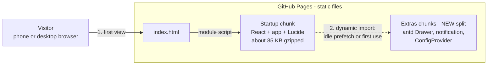
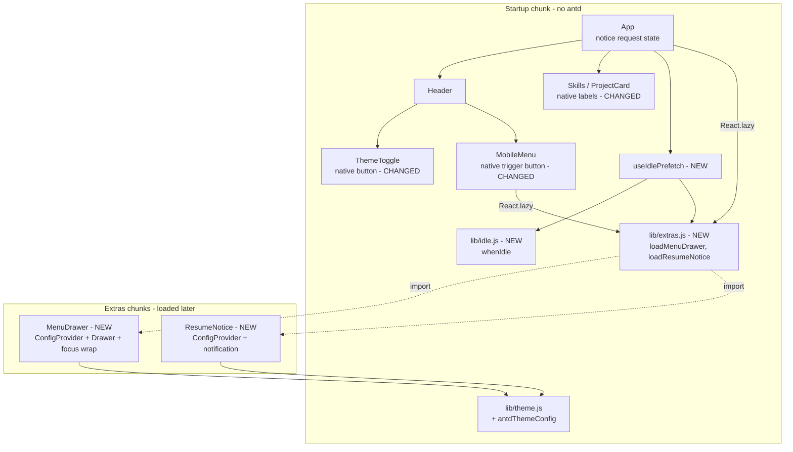
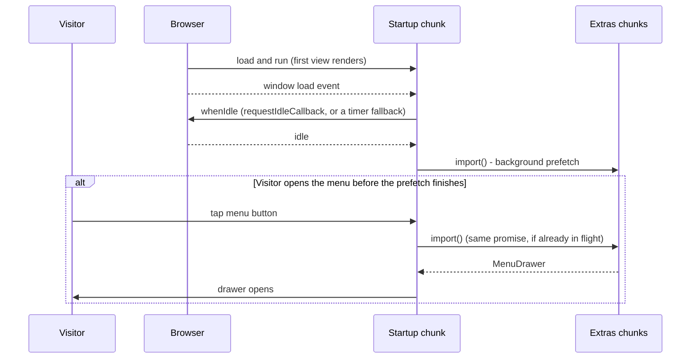

## Context

CI's Lighthouse Performance score sits on the edge of its 90 threshold, because
of Total Blocking Time spent starting up JavaScript (see `proposal.md`). The one
startup bundle is 157 KB gzipped (482 KB minified):

| Part | Minified | Share |
| --- | --- | --- |
| react-dom | 202 KB | 42% |
| antd's helper packages (rc-*, cssinjs, icons) | 130 KB | 27% |
| antd | 94 KB | 20% |
| App code, React, Lucide, other | 51 KB | 11% |

antd reaches startup through five static imports:

- `App.jsx`: `ConfigProvider`, `notification`, `theme`
- `Skills.jsx` and `ProjectCard.jsx`: `Tag`
- `ThemeToggle.jsx`: `Button`
- `MobileMenu.jsx`: `Button`, `Drawer`

Only the `Drawer` and the notice need antd's behaviour, and neither is visible
on the first view. The tags and the two icon buttons are simple enough for
native HTML.

The delta spec (`specs/site-quality/spec.md`) lowers the startup JavaScript
budget to 100 KB gzipped. It also requires the menu drawer and the résumé
notice to load after the first view, be prefetched when the browser is idle, and
load on demand if used earlier.

`scripts/check-bundle-size.js` already measures only what `index.html` loads (its
module script and `modulepreload` links). Chunks that Vite splits out for
dynamic `import()` are therefore excluded automatically, as the spec requires.

In-force ADRs (all Accepted, none superseded):

- ADR-0001: static SPA, no router or backend
- ADR-0002: Bootstrap for layout, antd for interactive components
- ADR-0003: Vitest and Playwright
- ADR-0004: GitHub Pages and Actions
- ADR-0005: self-hosted fonts through Fontsource

Native buttons for the theme toggle and the menu trigger stretch ADR-0002's rule
("interactive widgets go to antd"). See Open Questions.

### Container view (unchanged)

The site is still one static SPA container on GitHub Pages with no backend
(ADR-0001). The only container-level change is that the browser now downloads
the JavaScript in two waves.

### Components (inside the SPA container)

- Everything on the first view renders from the startup chunk alone.
- `lib/extras.js` is the single place that names the dynamic imports. Lazy
  rendering and idle prefetch share the same loader functions, so a prefetched
  module is reused from the browser's module cache when it is first rendered.
- Both extras build their own `ConfigProvider` from one shared
  `antdThemeConfig(theme)`, so their theming is identical to today's.

### Load sequence

Stakeholders: visitors on slower phones (startup time), and the owner (a CI gate
that passes reliably).

## Goals / Non-Goals

**Goals:**

- No antd code in the startup JavaScript. The startup bundle is at most 100 KB
  gzipped, enforced by `check:size`.
- The menu drawer and the résumé notice behave exactly as today, including on a
  first use that arrives before the prefetch has finished.
- Labels and buttons look the same as today in both themes, with the same
  accessible names, focus rings, and keyboard behaviour.
- Automated proof: an end-to-end check that the extras are not loaded with the
  first view, are prefetched when idle, and work when used before the prefetch.

**Non-Goals:**

- Removing antd from the project, or replacing the `Drawer` or notification
  (the proposal chose "out of startup, kept").
- Any visual or content change.
- Changing Lighthouse thresholds or the number of Lighthouse runs.
- Splitting react-dom or switching to another React renderer.
- Server-side rendering or pre-rendering.

## Decisions

### D1. Lazy boundary: two small extras components

`MenuDrawer` (new, under `components/MobileMenu/`) holds the antd `Drawer`, the
menu content, and the existing Tab-wrapping focus fix. `ResumeNotice` (new,
`components/ResumeNotice/`) holds the antd notification. Each wraps itself in a
`ConfigProvider` built by a new pure function, `antdThemeConfig(theme)`, in
`lib/theme.js`, so the antd theme lives in one tested place.

- `MobileMenu` keeps its state, its native trigger button, and the
  close-then-scroll logic. It mounts `<MenuDrawer>` inside `Suspense` from the
  first open onward, and keeps it mounted afterwards so the close animation and
  `afterOpenChange` focus return work as today.
- `App` replaces `notification.useNotification` with a notice request counter.
  The résumé hook's `onUnavailable` increments it. While the counter is above
  zero, `App` renders `<ResumeNotice requestId={n} theme={theme}>` inside
  `Suspense`. `ResumeNotice` opens the notice (same key, role, placement, text,
  and "Go to Contact" link) whenever `requestId` changes.
- The `Suspense` fallback is `null`. Until the code arrives nothing is shown,
  and the trigger stays focused and pressed (`aria-expanded="true"` on the menu
  button).

Alternatives:

- **One `ConfigProvider` kept around the whole app:** this is what pulls antd
  into startup today.
- **Moving the notice into a native `role="alert"` box:** smaller, but it
  changes the notice's look and behaviour, which is out of scope.
- **A single combined extras module:** simpler to name, but a menu tap would
  also download the notice code. Separate entry points let Rollup share the
  common antd code in one chunk, and keep each entry small.

### D2. One loader module and an idle prefetch

`lib/extras.js` exports `loadMenuDrawer` and `loadResumeNotice`, each a plain
`() => import(...)`. Both `React.lazy` and the prefetch use them, so the browser
fetches and evaluates each module once.

`lib/idle.js` exports `whenIdle(callback)`:

- It waits for the window `load` event, then calls `requestIdleCallback`.
- Where `requestIdleCallback` is missing (Safari, jsdom), it falls back to a
  short `setTimeout`.
- It returns a cancel function.

`useIdlePrefetch(loaders)` calls `whenIdle` once on mount, runs the loaders, and
ignores failures. A failed prefetch only means the extra loads on first use.

Alternatives:

- **Prefetch on hover or focus:** rejected in the proposal, since touch phones
  have no hover.
- **`<link rel="prefetch">` tags for the chunk URLs:** these download without
  evaluating, but the hashed chunk URLs are only known at build time. That
  would need a custom Vite plugin, which is more machinery than the risk
  warrants (see Risks).
- **A `manualChunks` setting:** not needed, because Rollup's automatic splitting
  of dynamic imports already produces the right boundary.

### D3. Native labels and buttons, pixel-matched

- **Labels:** `Tag` becomes a `` inside the existing
  `tag-list` items.
- **Icon buttons:** the theme toggle and the menu trigger become
  `<button type="button" className="icon-button">`, keeping their
  `aria-label`, `aria-expanded`, and `aria-controls`. The Lucide icon is still
  `aria-hidden`.
- **Styles:** `.tag` and `.icon-button` go in `global.css`, coloured with
  `tokens.css` custom properties, so both themes work without JavaScript. The
  values are copied from antd's computed styles in both themes before the swap
  (size, padding, border, radius, background, hover and active fills, and
  transitions under the existing reduced-motion rules). New tokens, such as
  `--color-tag-bg` and `--color-fill-hover`, are added only where antd used a
  colour that has no token today.
- **Focus:** the existing `:focus-visible` outline applies to the native
  buttons.

**Verification:** during apply, Playwright screenshots of the header and of the
Skills and Projects sections are taken before and after the swap, in both
themes, at mobile and desktop widths. They are compared as a one-off check, not
committed baselines, because rendering differs across operating systems. The
existing visual-style, accessibility, and axe suites remain the lasting guard.

### D4. Budget and measurement

`BUDGETS.js` in `scripts/check-bundle-size.js` drops from `200 * 1024` to
`100 * 1024`, matching the spec. The measurement code doesn't change, because it
already counts only what `index.html` loads.

The expected result is about 85 KB, leaving roughly 15% headroom. If the measured
size is well away from that, apply stops and asks the owner before changing the
spec number.

### D5. Tests

- **Unit (Vitest + RTL):**
  - `whenIdle`: runs after `load` and idle; uses the timer fallback when
    `requestIdleCallback` is missing; can be cancelled. Tested with fake timers.
  - `useIdlePrefetch`: calls each loader once, and swallows a rejected loader.
  - `antdThemeConfig`: dark and light algorithms, with the accent colour from
    `ACCENT_COLORS`.
  - `ThemeToggle`, `MobileMenu`, `Skills`, `ProjectCard`: queries move from antd
    markup to native elements. `MobileMenu` awaits the lazy drawer with
    `findByRole('dialog')`.
  - `App`: the résumé notice appears after the lazy load.
- **End-to-end (Playwright, all four projects), in a new
  `e2e/startup-javascript.spec.js` for the new requirement:**
  - A response listener records each JavaScript file and whether its body
    contains antd's drawer or notification code (by its class prefixes). This
    avoids depending on hashed chunk names.
  - *First view:* by the `load` event, no recorded script contains the extras.
    The theme toggle works, and the menu button and labels are visible.
  - *Idle prefetch:* without interaction, a script containing the extras arrives
    shortly after load.
  - *Used before arrival:* a route handler holds back extras scripts. The
    visitor opens the menu (mobile) or triggers the unavailable résumé. Then the
    scripts are released, and the drawer or notice appears and works.
- **Bundle:** `check:size` in CI enforces the new 100 KB budget.

### D6. Docs and leftovers

- The README quality-targets table shows the 100 KB JavaScript budget.
- In `global.css`, the `.tag-list .ant-tag` selectors become `.tag`.
- The `main.jsx` comment about antd load order is reworded, because antd styles
  now arrive later.
- The `tokens.test.js` antd accent test moves to `antdThemeConfig`.

## Risks / Trade-offs

- **[Risk] The idle prefetch evaluates antd shortly after load, inside
  Lighthouse's measuring window, and adds blocking time.** → The prefetch waits
  for `load` plus an idle period. Evaluating the module only defines components
  (antd's CSS-in-JS runs on first render, which never happens without
  interaction). During apply, Lighthouse runs locally on the built site; if
  Total Blocking Time rises, the idle wait gets a minimum delay. A `<link
  rel="prefetch">` plugin stays the fallback (see Open Questions).
- **[Risk] A first menu tap on a slow connection waits for the extras
  download.** → The prefetch makes this rare. The button shows
  `aria-expanded="true"` immediately, and the drawer appears once loaded. An
  end-to-end test covers this path.
- **[Risk] The native labels and buttons drift from antd's look.** → Their
  values are copied from computed styles and checked with the before/after
  screenshot comparison (D3).
- **[Risk] `aria-controls` names a drawer id that doesn't exist until the first
  open.** → It's the same as today, because antd only mounts the drawer when it
  opens. axe accepts a missing target while `aria-expanded="false"`. The axe
  suite runs before and after the menu opens.
- **[Risk] Errors during the lazy load (offline, or a deploy that changed chunk
  hashes).** → A failed prefetch is ignored. A failed first use leaves the menu
  closed, while the in-page nav links in the header (desktop) and section
  anchors still work. A small error boundary around each `Suspense` keeps a
  load failure from blanking the page.
- **[Trade-off]** There are two kinds of button in the codebase: native for
  simple icon actions, antd inside the extras. This is accepted, and recorded as
  a rule in the ADR step.

## Migration Plan

There's no data or URL change. The change ships as a normal feature branch, PR,
and merge to `main`, then GitHub Pages redeploys. Visitors who still have the
old page open keep the old single bundle until they reload. To roll back, revert
the merge commit.

## Open Questions

- **ADR-0002 needs revisiting.** Its rule says interactive widgets go to antd,
  and it cites the old 200 KB budget. This design uses native buttons for simple
  icon actions and loads antd only on demand. The recommendation is a new
  ADR-0006, "Keep antd out of the startup path", that supersedes ADR-0002 and
  restates its layout rule with the refined component rule:
  - Bootstrap for layout.
  - Native HTML for labels and simple buttons.
  - antd for complex widgets, loaded on demand.
  - The startup budget is enforced by `check:size`.
  
  The adr step decides this.
- **Fallback if the idle prefetch shows up in Lighthouse blocking time:** a
  fixed minimum delay, or a `<link rel="prefetch">` build plugin. This will be
  decided during apply from the local measurement, and the owner will be asked
  if the plugin is needed.
