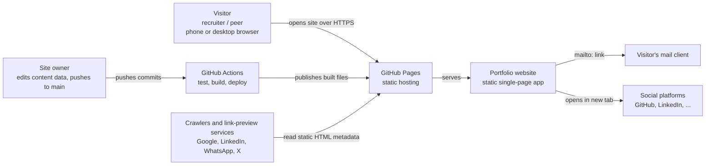
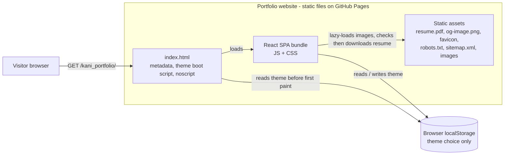
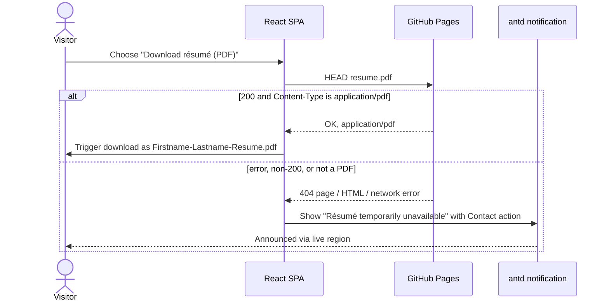

## Context

The repository contains only the intent-driven OpenSpec template: no application
code, an empty `package.json`, no existing specs under `openspec/specs/`, and no
ADRs under `adr/`. This change builds the first version of a personal portfolio
as defined in `proposal.md` and the eight capability specs.

Fixed constraints (from `CLAUDE.md` and the proposal):

- React + Vite, JavaScript only, ES modules, Node 24.
- No backend, no database, no router; one page with anchor navigation.
- Bootstrap and Ant Design for styling and UI, plus plain HTML/CSS; Lucide icons.
- Mobile-first, lightweight, semantic HTML for SEO and accessibility.
- Playwright for end-to-end tests; strict TDD during apply.

Hosting decision taken during design: **GitHub Pages**, deployed from the
`Kanialagar-Labglo/kani_portfolio` repository by GitHub Actions. The default
site URL is therefore `https://kanialagar-labglo.github.io/kani_portfolio/`,
which serves the app under the `/kani_portfolio/` base path.

Stakeholders: the site owner (edits content data, deploys) and visitors
(recruiters, hiring managers, peers) on phones and desktops.

### System context



- The portfolio has no server of its own; everything it needs is in the built
  static files.
- The only outbound interactions are user-initiated: a `mailto:` link and
  social links in new tabs.
- Crawlers and link-preview services read `index.html` without running
  JavaScript, which drives the build-time metadata decision (D8).

### Containers



- There is a single deployable unit: the static `dist/` output of `vite build`.
- `localStorage` holds only the visitor's theme choice; no personal data is
  stored or sent anywhere.

## Goals / Non-Goals

**Goals:**

- Deliver every requirement in the eight capability specs with a structure that
  later changes (new sections, real content, custom domain) can extend without
  rework.
- Keep the initial bundle within 200 KB JS / 40 KB CSS gzipped and meet the
  Lighthouse and Core Web Vitals targets.
- Make each spec scenario testable: logic in plain modules and hooks covered by
  unit tests; observable behaviour covered by Playwright.
- Let the owner change all content by editing data modules only.
- Automate test, build, and deploy to GitHub Pages on every push to `main`.

**Non-Goals:**

- Backend, database, contact form, analytics, CMS, or server-side rendering.
- Client-side routing or multiple pages.
- Internationalisation (English only).
- Real portfolio content (placeholders only in this change).
- Custom domain (supported later by changing configuration; see Open Questions).

## Decisions

### D1. Single Vite + React SPA, no router, static output

One Vite project at the repository root produces static files in `dist/`. The
page is a single React tree; navigation uses native anchor links (`#about`,
`#projects`, …).

- **Why:** matches the "SPA, no routes" constraint, needs no server, and Vite
  gives fast builds and simple static output for GitHub Pages.
- **Alternatives:** Next.js/Astro static export — more SEO power (pre-rendered
  HTML) but adds a framework and conventions beyond the agreed stack; React
  Router with hash routes — unnecessary for one page and adds bundle weight.

### D2. Project layout

```
index.html                 # metadata placeholders, theme boot script, noscript
vite.config.js             # React plugin, base path, SEO/crawler plugin
site.config.js             # siteUrl, basePath (single source for hosting values)
public/                    # resume.pdf, og-image.png, favicon, images
src/
  main.jsx                 # entry: styles, ConfigProvider, <App />
  App.jsx                  # page shell: SkipLink, Header, main sections, Footer
  data/                    # profile.js, skills.js, projects.js, experience.js, socials.js
  components/              # one folder per component: Header/, Hero/, Projects/, ...
    Header/Header.jsx
    Header/Header.test.jsx # co-located unit/component tests
  hooks/                   # useTheme, useActiveSection, useResumeDownload
  lib/                     # pure helpers: sections.js, resume.js, seo.js, theme.js
  styles/                  # bootstrap.scss (selected partials), tokens.css, global.css
e2e/                       # Playwright specs, grouped by capability
scripts/                   # check-bundle-size.js
.github/workflows/         # ci-deploy.yml
.nvmrc                     # 24
```

- **Why:** content (`data/`), behaviour (`hooks/`, `lib/`), and presentation
  (`components/`) are separated so the owner edits data only and logic is unit
  testable without rendering. Co-located tests keep each component's tests
  next to it; Playwright tests live in `e2e/` grouped by spec capability so each
  scenario is easy to trace.
- **Alternatives:** `src/features/<capability>/` folders — reasonable, but most
  capabilities here map to one or two components, so per-component folders are
  simpler.

### D3. Bootstrap for layout and utilities only (selected Sass partials, no Bootstrap JS)

Bootstrap 5.3 is consumed as Sass, importing only functions, variables, maps,
mixins, root, reboot, containers, grid, and utilities. Bootstrap's JavaScript is
not used.

- **Why:** the grid and spacing utilities give a robust mobile-first layout with
  minimal CSS; importing selected partials keeps CSS well under the 40 KB
  budget. Dropping Bootstrap JS avoids two competing component libraries.
- **Cost:** adds `sass` as a dev dependency.
- **Alternatives:** full `bootstrap.min.css` (~25 KB gzipped, mostly unused
  component styles); Bootstrap JS for the collapse menu — would duplicate antd
  and break the "one library per job" rule.

### D4. Ant Design for interactive components

antd provides the interactive pieces: `Button`, `Drawer` (mobile menu),
`Tag` (skills and technologies), `Card` (projects), `Timeline` (experience), and
`message`/`notification` (résumé fallback notice). Components are imported by
name from the package's ES modules so unused components are tree-shaken.

- **Why:** antd's `Drawer` already handles focus containment, Escape, and
  click-outside closing required by the mobile-menu scenarios; its
  `ConfigProvider` dark algorithm themes every antd component at once.
- **Trade-off:** antd is the largest dependency and uses CSS-in-JS, so its styles
  count toward the JS budget. Mitigated by importing only the components above
  and by the bundle-size check (D10).
- **Alternatives:** Bootstrap components for everything — lighter but conflicts
  with the agreed use of antd; headless libraries — more work, not in the stack.

### D5. Theming: one resolved theme applied to three systems

- A tiny inline script in `index.html` runs before the app: it reads the saved
  choice from `localStorage` (inside `try/catch`), falls back to
  `prefers-color-scheme`, then light, and sets `data-bs-theme` and
  `data-theme` on `<html>`. This gives the correct first paint.
- The `useTheme` hook reads that initial value, toggles it, writes it to
  `localStorage` (ignoring storage errors), and updates the `<html>`
  attributes.
- Bootstrap reads `data-bs-theme`; antd receives `theme.darkAlgorithm` or
  `theme.defaultAlgorithm` through `ConfigProvider`; custom CSS uses CSS custom
  properties defined per `[data-theme]` in `tokens.css`.
- Colour transitions are wrapped in `@media (prefers-reduced-motion: no-preference)`.
- **Why:** a single resolved value keeps the three styling systems in sync and
  avoids a flash of the wrong theme.
- **Alternatives:** CSS-only `prefers-color-scheme` — cannot remember an explicit
  choice; setting the theme only in React — causes a flash on load.

### D6. Navigation built on native anchors

- Links are plain `<a href="#section">`, which gives shareable fragments, deep
  links on load, and no address changes while scrolling.
- Smooth scrolling is CSS `scroll-behavior: smooth` inside
  `@media (prefers-reduced-motion: no-preference)`; every section has
  `scroll-margin-top` equal to the header height (a CSS custom property).
- `useActiveSection` listens to `scroll` and `resize` (passive, at most one
  update per animation frame) and passes section positions to a pure function
  (`lib/activeSection.js`): the active section is the last one whose top has
  reached a reading line 30% down the viewport, or the last section when the
  page is scrolled to the bottom. It returns the current id; the matching link
  gets `aria-current="location"` and an active style.
- In-page links opened directly (for example `/#projects`) are scrolled to once
  React has rendered the sections, because the browser's own jump happens
  before the section exists.
- Inside the mobile `Drawer`, choosing a link closes the drawer first and
  scrolls after it has closed, because the page cannot scroll while the drawer
  is open.
- The list of visible sections is derived once by a pure function
  (`lib/sections.js`) from the data modules, so a section with no data
  disappears from both `main` and the navigation.
- Below 768 px the links render inside an antd `Drawer` opened by a menu button.
  Choosing a link closes the drawer; focus is explicitly returned to the menu
  button on close.
- **Alternatives:** JavaScript `scrollIntoView` for all navigation — needs manual
  history handling; a scroll-spy library — unnecessary dependency;
  `IntersectionObserver` for the active section — rejected during apply because
  it does not fire when the visitor reaches the very bottom of the page, so a
  short last section (Contact) would never become active.

### D7. Résumé download with a verified-file fallback



- The download control is a real `<a href download="…">` so it works with the
  keyboard and assistive technology. Its click handler prevents the default,
  runs the check above, then triggers the download programmatically.
- If `HEAD` is not allowed (405), the check falls back to a `GET` and inspects
  the response type.
- If no résumé path is configured in `profile.js`, no download control is
  rendered.
- The check logic lives in `lib/resume.js` (pure, unit tested with a mocked
  `fetch`); `useResumeDownload` wires it to the UI.
- **Why:** GitHub Pages and the Vite dev server can answer a missing file with
  an HTML page, so a plain link could download a broken "PDF". Checking the
  content type catches both a real 404 and an HTML fallback.

### D8. Metadata generated at build time

A small custom Vite plugin in `vite.config.js`:

- reads `src/data/profile.js`, `src/data/socials.js`, and `site.config.js`;
- replaces placeholders in `index.html` (`transformIndexHtml`) with the title,
  description, canonical URL, Open Graph and Twitter/X tags, theme colours, and a
  JSON-LD `Person` block;
- emits `robots.txt` and `sitemap.xml` into the build output;
- logs a warning, without failing, when `siteUrl` is empty.

String building lives in `lib/seo.js` (pure, unit tested); the plugin only
wires it into Vite.

- **Why:** link-preview services do not run JavaScript, so metadata must be in
  the delivered HTML; generating it from the same data modules keeps one source
  of truth.
- **Alternatives:** `react-helmet` — runs in the browser, invisible to preview
  services; hand-written tags in `index.html` — duplicates profile data.

### D9. Hosting on GitHub Pages under a base path

- `site.config.js` holds `siteUrl` (`https://kanialagar-labglo.github.io/kani_portfolio/`)
  and `basePath` (`/kani_portfolio/`). `vite.config.js` sets `base` from it.
- Every asset reference (résumé, images, Open Graph image) uses Vite's
  `import.meta.env.BASE_URL` or the configured `siteUrl`, never a hard-coded
  `/`.
- A custom domain later means changing these two values only.
- **Alternatives:** Netlify or Vercel — would add a second platform account; the
  repository already lives on GitHub.

### D10. Testing and quality tooling

| Concern | Tool | Notes |
| --- | --- | --- |
| Unit / component (TDD) | Vitest + React Testing Library + jsdom | Native to Vite, same config, fast watch mode. |
| End-to-end | Playwright | Projects: desktop Chromium, desktop Firefox, Pixel (mobile Chrome), iPhone (mobile WebKit). Runs against the production build via `vite preview`. |
| Accessibility | `@axe-core/playwright` | Scans the full page in light and dark themes; fails on serious or critical issues. |
| Lighthouse | Lighthouse CI (`@lhci/cli`) | Mobile preset with the score assertions from `site-quality`; runs in CI. |
| Bundle size | `scripts/check-bundle-size.js` | Node `zlib` gzip of the initial JS and CSS in `dist/`; fails above 200 KB / 40 KB. No extra dependency. |
| Lint / format | ESLint (flat config, `react`, `react-hooks`, `jsx-a11y`) + Prettier | `jsx-a11y` catches accessibility mistakes early. |

- Spec scenarios map to tests: behaviour that needs a real browser (scrolling,
  focus, viewport layout, downloads, metadata in built HTML) goes to Playwright;
  pure logic (section visibility, résumé check, SEO strings, theme resolution)
  goes to Vitest.
- **Alternatives:** Jest — needs extra transform setup for Vite/ESM; Cypress —
  Playwright is already fixed by `CLAUDE.md`; `size-limit` — an extra
  dependency for a check a 30-line script covers.

### D11. CI and deployment with GitHub Actions

One workflow, `ci-deploy.yml`:

1. On every push and pull request: install with `npm ci` on Node 24, lint, run
   unit tests, build, check bundle size, run Playwright (all four projects) and
   Lighthouse CI against the built site.
2. On push to `main` only, after all checks pass: upload `dist/` with
   `actions/upload-pages-artifact` and publish with `actions/deploy-pages`.

- **Why:** the quality targets in `site-quality` are enforced automatically,
  and broken builds never reach the live site.

## Risks / Trade-offs

- [antd pushes the JS bundle towards the 200 KB budget] -> Import only the
  listed components, check size in CI, and record any budget change as a new
  decision rather than silently raising it.
- [Bootstrap reboot and antd base styles conflict] -> Load Bootstrap first and
  antd second, use antd's `cssVar`/token theming, and cover visual states of
  antd components with Playwright screenshots in both themes if conflicts
  appear.
- [GitHub Pages base path breaks absolute asset URLs] -> All URLs go through
  `BASE_URL` or `siteUrl`; an e2e test runs against `vite preview` with the same
  base path.
- [An SPA without pre-rendering is weaker for search than static HTML] ->
  Metadata and structured data are in the static HTML; content is small and
  Google renders JavaScript. Pre-rendering is a possible later change.
- [Playwright WebKit differs from real Safari] -> Manual check on a real iPhone
  before the first public release.
- [Lighthouse scores vary between runs] -> Lighthouse CI runs three times and
  asserts on the median.
- [The theme boot script is inline] -> Kept tiny and static; if a Content
  Security Policy is added later it needs a hash for this script.
- [HEAD requests may be blocked or uncached by some hosts] -> Fall back to
  `GET` (D7).

## Migration Plan

This is a greenfield change; no existing behaviour or data needs migrating.

1. Owner enables GitHub Pages for the repository with **GitHub Actions** as the
   source (Settings → Pages). This is a one-time manual step.
2. Merge the implementation to `main`; the workflow tests, builds, and deploys.
3. Verify the live site at `https://kanialagar-labglo.github.io/kani_portfolio/`
   and a link preview on one social platform.
4. Rollback: revert the offending commit on `main` (the workflow redeploys the
   previous version), or re-run the last successful deployment from the Actions
   tab.

## Open Questions

- **Custom domain:** not planned yet. Adding one changes `siteUrl` and
  `basePath` and needs a `CNAME`; it can be its own small change.
- **Real content and assets:** the owner must supply the real résumé PDF, profile
  photo, project screenshots, and a 1200×630 preview image; placeholders ship in
  this change.
- **antd major version:** pin the current stable major at install time and
  confirm its dark-algorithm and `Drawer` focus behaviour match D4–D6.
- **ADR candidates for the next step:** static Vite SPA without router or
  backend (D1); Bootstrap-for-layout / antd-for-components split (D3–D4);
  testing strategy and tools (D10); GitHub Pages hosting with GitHub Actions
  (D9, D11). No in-force ADRs exist yet, so nothing needs superseding.
