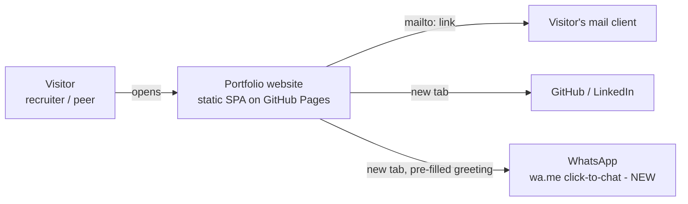
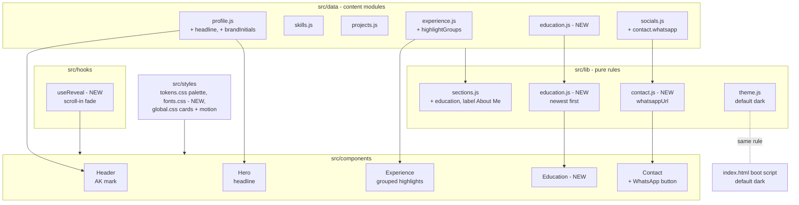

## Context

The portfolio from `create-portfolio-site` is live on GitHub Pages with
placeholder content and a neutral light/dark look. This change (see
`proposal.md` and the seven delta specs) fills in the owner's real content, adds
an Education section and a WhatsApp chat button, makes dark the default theme,
and gives the site a developer-style visual identity.

Current state that shapes the design:

- Content lives in `src/data/*.js` and flows through `content` in `App.jsx`.
  `src/lib/sections.js` decides section order, nav labels, and which sections
  are visible. The Hero is already in the nav as "Home".
- Theme resolution exists twice by design: `resolveTheme` in `src/lib/theme.js`
  and an inline boot script in `index.html` that runs before first paint.
- Styles are `tokens.css` (CSS custom properties per theme), `global.css`,
  selected Bootstrap Sass partials, and antd themed through `ConfigProvider`.
- The build-time SEO plugin writes `theme-color` meta tags for light and dark
  from constants that mirror `--color-bg`.

In-force ADRs (all Accepted, none superseded): ADR-0001 static SPA with no
router or backend, ADR-0002 Bootstrap for layout and antd for interactive
components, ADR-0003 Vitest and Playwright, ADR-0004 GitHub Pages and Actions.
This design stays within all four. The WhatsApp button is a plain outbound link,
so ADR-0001's no-backend rule holds.

### System context (what changes)

- The only new external interaction is the user-initiated `wa.me` link. The
  site still sends nothing to any server.
- The font is bundled with the site, so there is no new third-party request.

### Components (inside the single SPA container)

- Data stays the single source of content (spec: content comes from editable
  data). Every new behaviour is a pure function in `src/lib` with unit tests,
  and components stay thin.
- `useReveal` is the only new runtime behaviour beyond rendering. It is
  optional by construction: without it, everything is visible.

Stakeholders: the owner (job applications, editing data) and visitors
(recruiters on phones and desktops).

## Goals / Non-Goals

**Goals:**

- Ship the owner's real content with no placeholder text left on the page.
- Add Education and WhatsApp with the same data-driven, hide-when-empty pattern
  as the existing sections.
- Dark by default from the first painted frame, with the toggle and remembered
  choice unchanged.
- A distinctive developer look that keeps WCAG AA contrast, the bundle budget,
  and the Lighthouse targets.

**Non-Goals:**

- No blog, certifications, HRMS project, or extra projects.
- No profile photo or real résumé yet. The existing optional-photo and
  missing-résumé behaviour covers both until the files arrive.
- No animation library, CSS framework change, or icon set change.
- No new hosting, analytics, or contact form.

## Decisions

### D1. Data shapes

Additions are backwards-compatible, so a missing field keeps today's behaviour:

| Module | Change |
| --- | --- |
| `profile.js` | Adds `headline` (optional; the Hero falls back to `role`) and `brandInitials: 'AK'` (header mark). `role` stays the short "Full-Stack Developer" for the title, link previews, and JSON-LD. |
| `experience.js` | An entry has either `highlights: string[]` or `highlightGroups: { name, items: string[] }[]`. |
| `education.js` (new) | `[{ qualification, institution, year }]`, with year as a number. |
| `socials.js` | `contact.whatsapp = { number: '918248570855', message: '…' }`, with the number as international digits only. |

`brandInitials` is explicit rather than derived, because "Kani Alagar A" would
derive to "KAA" and the owner's brand is "AK".

Alternatives: deriving initials from the name was rejected for the reason above.
A single `highlights` list with "Group: text" strings was rejected because it
mixes structure into text.

### D2. Sections and navigation

Add `{ id: 'education', label: 'Education' }` to `SECTIONS` in
`src/lib/sections.js` between Experience and Contact, visible when the education
data is non-empty. Change the About label to "About Me". Make Contact visible
when there is an email, a social link, or a WhatsApp number. "Home" already
exists, so the navigation needs only the label and order changes. Active-section
tracking and the mobile menu already work from this list.

### D3. Education

`src/lib/education.js` exports `sortByYearDesc` (pure and tested). The
`Education` component renders an ordered list of cards, each with the
qualification as `h3`, the institution, and the year. It reuses `PageSection`
and the card styles from D7.

### D4. Grouped experience highlights

`Experience` renders `highlightGroups` when present: each group name as an `h4`
followed by its `ul`. Otherwise it renders the flat `highlights` list. The
heading order stays logical (h2 section, h3 role, h4 group). The 2–4 limits are
content rules covered by a data-validation unit test, not enforced at runtime.

### D5. WhatsApp chat link

`src/lib/contact.js` exports `whatsappUrl({ number, message })`. It returns
`https://wa.me/<digits>?text=<encoded message>` and strips non-digits. `Contact`
renders it as a styled link reading "Chat on WhatsApp", with a Lucide
`MessageCircle` icon (generic icon plus label, as before) and a visually hidden
"(opens in a new tab)". The link has `target="_blank"` and
`rel="noopener noreferrer"`.

The number appears only inside the `href`. It is never shown as text and never
written into JSON-LD.

Alternatives: `api.whatsapp.com/send` works but is longer, and `wa.me` is
WhatsApp's documented short form. A `tel:` link was rejected because the request
is chat, and showing the number was declined during the proposal.

### D6. Dark by default

`resolveTheme({ saved })` returns the saved theme when it is valid, otherwise
`'dark'`. The `index.html` boot script drops its `matchMedia` check and keeps
the same order (saved, then dark). The comment linking the two stays.

The SEO plugin's two media-scoped `theme-color` tags become a single dark
`theme-color`, because a first visit is always dark. `useTheme` and the toggle
are unchanged.

### D7. Palette, cards, and code-style details

Tokens in `tokens.css` (initial values; contrast is confirmed by axe and a token
contrast unit test during apply):

| Token | Dark (default) | Light |
| --- | --- | --- |
| `--color-bg` | `#0a0d14` near-black | `#ffffff` |
| `--color-surface` (cards) | `#111725` | `#f5f7fb` |
| `--color-text` | `#e6edf3` | `#161b26` |
| `--color-text-muted` | `#9aa6b8` | `#4f5b6d` |
| `--color-accent` (blue) | `#5ea8ff` | `#0b5cad` |
| `--color-accent-2` (purple) | `#b18cff` | `#6d3fd1` |
| `--color-border` | `#232c3d` | `#d5dbe5` |

antd receives `token.colorPrimary` from `--color-accent` per theme through the
existing `ConfigProvider`, so buttons, drawer, and notice match.

The code-inspired details stay decorative and accessible:

- A muted `//` before section headings, in an `aria-hidden` span added by `PageSection`.
- A `>` prompt before the Hero tagline.
- A blue-to-purple gradient on the AK mark and on heading underlines.
- A subtle grid background on the Hero only.

Gradients never carry body text, so contrast is always measured against solid
colours.

Cards (projects, experience, education) share one `.card-surface` class: a
surface background, a 1 px border, and a radius. Bootstrap still provides the
grid, per ADR-0002.

### D8. Self-hosted monospace font

Use `@fontsource/jetbrains-mono` 5.x, importing only `latin-400.css` and
`latin-700.css` from a new `src/styles/fonts.css`. Vite bundles the woff2 files
with hashed names under the same origin. Fontsource sets `font-display: swap`,
so text paints immediately in the fallback stack.

A `--font-display` token (`'JetBrains Mono', ui-monospace, SFMono-Regular,
Menlo, Consolas, monospace`) applies to headings, nav links, the Hero headline,
and skill and technology labels. Body text keeps the system stack. Two weights
total about 45 KB of woff2 against the 60 KB budget.

Alternatives:

- Copying font files into `public/` avoids a dependency but loses versioned
  updates and the bundled licence.
- A Google Fonts link adds a third-party request and was declined.
- System monospace only looks different on each device.

This choice is recorded in an ADR.

### D9. Motion

Hover and focus feedback is CSS only:

- Cards get an accent border and a `transform: translateY(-2px)` with a soft shadow.
- `:focus-visible` gets the same highlight.
- Transforms do not count as layout shift and don't move neighbouring cards.

Scroll-in fade uses a `useReveal` hook in `App`:

- One `IntersectionObserver` watches elements marked `data-reveal` (section
  bodies and cards).
- The hook adds `reveal-ready` to `<html>` only when `IntersectionObserver`
  exists and reduced motion is not requested. Only under `reveal-ready` does CSS
  start those elements at `opacity: 0; transform: translateY(8px)`.
- An element becomes visible once and is then unobserved.
- Anything already in the viewport on load is revealed at once.

Content is visible by default, so if JavaScript, the observer, or the hook
fails, nothing stays hidden. The existing global reduced-motion rule also zeroes
transitions.

Alternatives: CSS scroll-driven animations (`animation-timeline: view()`) need
no JavaScript, but browser support is still uneven, so they would give
inconsistent behaviour. An animation library was rejected for bundle size.

### D10. Branding assets

- `public/favicon.svg` becomes "AK" in the display style on a blue-to-purple
  gradient tile. It is plain SVG with outlined text paths, so it doesn't depend
  on fonts.
- The header link shows the AK mark, plus the full name from 768 px up. On small
  screens the name is visually hidden but still part of the link's accessible
  name.
- `public/og-image.png` (1200×630) is regenerated once with the name, role, and
  the new palette, and committed as a static asset like before.

### D11. Résumé placeholder removal

Delete `public/resume.pdf` and keep `resumePath: 'resume.pdf'`. The existing
availability check turns the 404 (an HTML page on GitHub Pages) into the
"unavailable" notice. Adding the real PDF later needs no code change. The e2e
download test serves its own small PDF through `page.route`, so it keeps testing
the download path.

### D12. Tests

- **Unit:**
  - `resolveTheme` defaults to dark.
  - `getVisibleSections` covers Education and the About Me label.
  - `sortByYearDesc` and `whatsappUrl`.
  - `Experience` renders grouped and flat highlights.
  - `Education`, the `Contact` WhatsApp link, the `Hero` headline fallback, and the `Header` mark's accessible name.
  - `useReveal` with and without reduced motion.
  - A data-validation test: no placeholder strings, groups of 2–4, description of 150–160 characters.
  - A token contrast check.
- **E2E:**
  - The theme-toggle first-visit outline changes to always dark.
  - New Education and WhatsApp scenarios.
  - Navigation order and section order.
  - A placeholder-text scan.
  - Font requests stay same-origin.
  - Hover leaves neighbours in place.
  - Reduced motion shows everything at once.
  - Axe in both themes, run after scrolling to the bottom so revealed content is checked at full opacity.
- **Scripts:** `check:size` also sums the bundled `.woff2` files against 60 KB.
  Lighthouse targets are unchanged.

## Risks / Trade-offs

- **[The font swap moves the LCP element or shifts layout]** → Only two weights.
  The fallback stack is monospace, so widths are close. Lighthouse CLS and LCP
  stay as CI gates.
- **[Faded-out content is missed by axe or by a visitor]** → Content is visible
  unless `reveal-ready` is set. Axe runs after a full scroll. An e2e test checks
  that every section is visible after scrolling.
- **[Dark-by-default ignores visitors who prefer light]** → The toggle stays
  visible at every width and the choice is remembered. This was accepted in the
  proposal.
- **[Accent colours fail contrast in one theme]** → A unit test checks the token
  pairs, and axe runs in both themes in CI.
- **[The WhatsApp number in page source attracts spam]** → Accepted by the
  owner. The number is only in the link, not in visible text or structured data.
- **[Recruiters click "Download résumé" and get the unavailable notice]** →
  Temporary and intended. The notice points to Contact. The owner adds
  `resume.pdf` when ready.
- **[A new dependency]** → `@fontsource/jetbrains-mono` ships only font files
  and CSS, with no runtime JS. It is pinned through the lockfile.

## Migration Plan

1. Merge the proposal artifacts to `main`, then apply on a feature branch, as
   before.
2. Visitors with a saved choice keep it. Visitors without one switch from the
   system preference to dark.
3. Deploy is the existing push to `main`. Roll back by reverting the merge
   commit: the site is static and nothing is stored server-side.
4. Later, adding `public/resume.pdf` or a profile photo needs only a data or
   file change, not a new OpenSpec change.

## Open Questions

- None blocking. The ADR step should record D8 (self-hosted font through
  Fontsource). D6 (dark by default) is product behaviour defined in the
  `theme-toggle` spec. No in-force ADR needs superseding.
